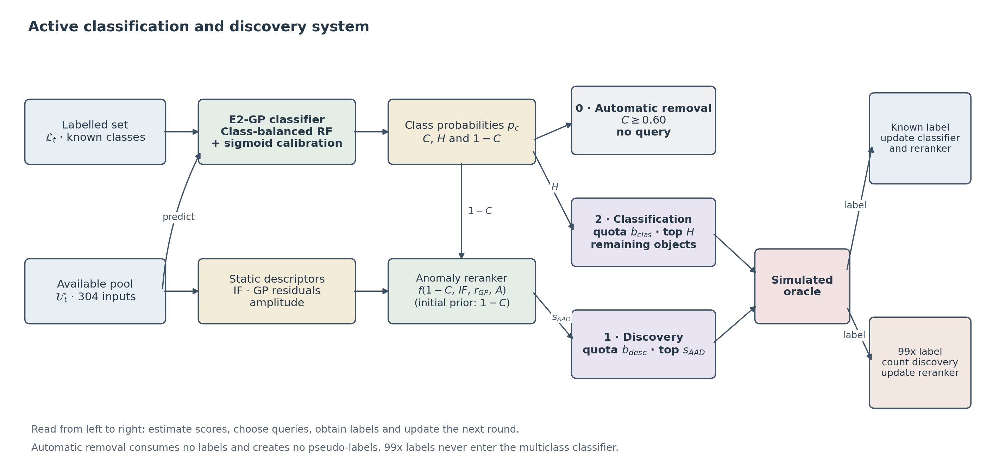

# Active classification and anomaly discovery in simulated LSST light curves

**Laura Coello Fernández · MSc in Data Science, Universidad Autónoma de Madrid**

Research code for a master's thesis using the PLAsTiCC simulation. The project
asks how a limited labelling budget can improve known-class classification while
also finding objects outside the initial taxonomy.

A two-channel policy allocates queries between classification uncertainty and
feedback-guided anomaly discovery. It is compared with confidence triage and
random sampling on individual batches and an eleven-batch pool of **352,691
objects**. All evaluations use simulated oracle labels and complete light curves.



## Scientific overview

- **Representation:** 304 numerical inputs from statistical/host descriptors,
  per-band GP1D fits, a joint time–wavelength GP2D fit and derived features.
- **Operational classifier:** a class-balanced Random Forest with 150 trees,
  minimum leaf size three and three-fold sigmoid calibration.
- **Acquisition:** known-class oracle labels update the classifier. Queried 99x
  labels count as anomaly discoveries and update the discovery component only.
  Automatic high-confidence removal creates no pseudo-labels.
- **Main comparison:** ten matched seeds at a 1,000-query budget. The two-channel
  policy finds 38 anomalies on average, compared with 12.5 for triage and 7 for
  random sampling. Its classification advantage over triage is positive on
  average but not conclusive in the paired test.

The analysis does not model streaming alerts, realistic follow-up costs or
uncertain oracle labels. SHAP describes the forests **before calibration**;
it does not exactly decompose the operational novelty score. Physical magnitude
and duration descriptors are approximate interpretation proxies.

## Explore the project

| Location | Purpose |
|---|---|
| [notebooks/](notebooks/README.md) | Ordered analysis, from data exploration to evaluation |
| `src/features/` | Photometric descriptors and validated feature caches |
| `src/models/` | Classifiers, acquisition policies and evaluation metrics |
| [scripts/](scripts/README.md) | Reproduction commands and figure generation |
| [data/processed/](data/processed/README.md) | Final experiment results and scientific provenance |
| `tests/` | Small synthetic tests of scientific and software invariants |

Read the [reproduction guide](REPRODUCIBILITY.md) for execution order and cache
requirements. The [data schema](DATA_SCHEMA.md) explains stable identifiers in
the saved results.

## Install and test

```bash
conda env create -f environment.yml
conda activate tfm2
python scripts/check_environment.py --full
python -m pytest -q
```

The environment pins the scientific package versions used by the saved model.
Tests use small synthetic inputs; they do not download PLAsTiCC or repeat the
large experiments. Raw data and large feature caches are deliberately excluded
from this repository. See [data/raw/README.md](data/raw/README.md) to obtain them.

Final scientific tables and the optional canonical classifier are included.
Notebook outputs are cleared for readable version control. Reusing a cached
feature table does not avoid every computation: classifier fitting, CV, example
GP fits and SHAP can still take time.

## Data and scope

PLAsTiCC Team and PLAsTiCC Modelers, *Unblinded Data for PLAsTiCC Classification
Challenge*: [doi:10.5281/zenodo.2539456](https://doi.org/10.5281/zenodo.2539456).

This is the research companion to the thesis, rather than an operational Rubin
alert classifier. The code, model, feature order and saved experiment settings
should be treated together when comparing or extending the results.
